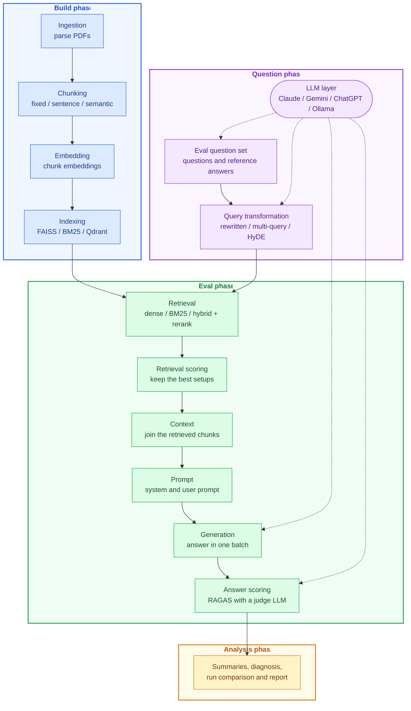

# RAG-Eval

A production-style RAG pipeline built layer by layer, from PDF ingestion to answer evaluation.

It runs on real-world PDF data and compares 3 chunking strategies, 5 indexes (FAISS flat, IVF and HNSW, BM25 and Qdrant), dense, BM25 and hybrid retrieval, 4 query types (original, rewritten, multi-query and HyDE) and cross-encoder reranking. Both the retrieved chunks and the generated answers are scored. All LLM calls go through one LLM layer, and Claude, Gemini, ChatGPT and a local Ollama model are each used for a different task.

### Key results

5,000 documents, 200 questions: 150 for validation (tuning) and 50 for test (used once).

| Set | Chunk recall | Faithfulness | Correctness | Relevance |
|---|---|---|---|---|
| Validation (150) | 0.93 | 0.89 | 0.61 | 0.57 |
| Test (50) | 0.88 | 0.89 | 0.55 | 0.64 |

- **Best setup:** sentence chunks, hybrid retrieval (FAISS + BM25, fused with RRF), top 20, no reranking.
- **Prompt tuning** raised correctness from 0.55 to 0.61 and halved "I don't know" answers.
- **Cost:** $4.88 to generate the 200-question eval set, $9.16 for the three tuning runs on the validation set, and $0.78 for the test run. Cached re-runs cost nothing.
## Architecture

The build phase turns the documents into searchable indexes. In parallel, the question phase creates the eval questions and the search queries made from them, with the LLM layer. The eval phase retrieves chunks for each query, generates answers and scores both, and the analysis phase turns the scores into a report. Each layer saves its output, so a re-run loads what has not changed instead of computing it again.

There are three entry points, all reading the same `config.yaml`:

| Script | Runs |
|---|---|
| `scripts/run.sh` | the whole pipeline (`src/pipeline.py`) |
| `scripts/build.sh` | the build phase only (`src/build.py`) |
| `scripts/eval.sh` | the eval phase only (`src/eval.py`) |
