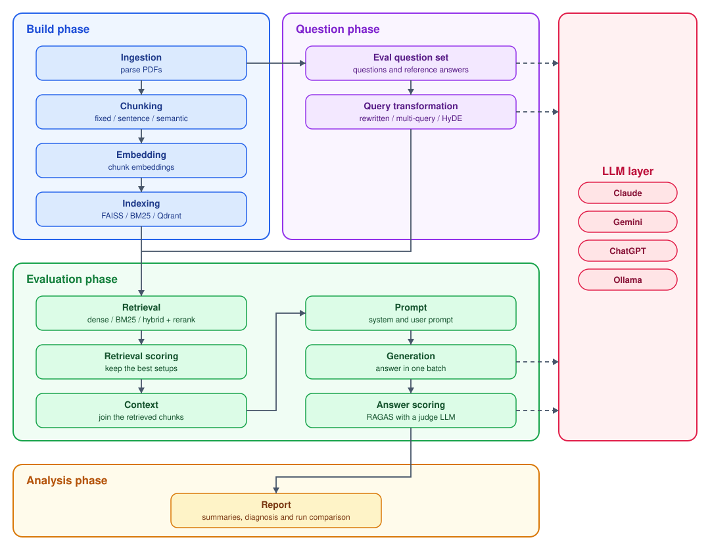

# RAG-Eval

A production-style RAG pipeline built layer by layer, from PDF ingestion to answer evaluation.

It runs on real-world PDF data and compares 3 chunking strategies, 5 indexes (FAISS flat, IVF and HNSW, BM25 and Qdrant), dense, BM25 and hybrid retrieval, 4 query types (original, rewritten, multi-query and HyDE) and cross-encoder reranking. Both the retrieved chunks and the generated answers are scored. All LLM calls go through one LLM layer, and Claude, Gemini, ChatGPT and a local Ollama model are each used for different tasks.

### Key results

5,000 documents, 200 questions: 150 for validation (tuning) and 50 for test (used once).

| Set | Chunk recall | Faithfulness | Correctness | Relevance |
|---|---|---|---|---|
| Validation (150) | 0.93 | 0.89 | 0.61 | 0.57 |
| Test (50) | 0.88 | 0.89 | 0.55 | 0.64 |

- **Best setup:** sentence chunks, hybrid retrieval (FAISS + BM25, fused with RRF), top 20, no reranking.
- **Prompt tuning** raised correctness from 0.55 to 0.61 and halved "I don't know" answers.
- **Cost:** $4.88 to generate the 200-question eval set, $9.16 for the three tuning runs on the validation set, and $0.78 for the test run. Cached re-runs cost nothing.
## Architecture

## Tech stack

| Layer | Tools |
|---|---|
| **Core** | Python 3.10, PyYAML config, Pydantic, NumPy, PyTorch, pytest (436 tests) |
| **Ingestion** | `doc_ingest` (PDF parsing with pypdfium2, MinHash deduplication), Hugging Face `datasets` |
| **Chunking** | Fixed, sentence and semantic chunkers implemented, NLTK for sentence splitting |
| **Embedding** | sentence-transformers (`all-MiniLM-L6-v2`) |
| **Indexing** | FAISS (flat, IVF, HNSW), `rank-bm25` for BM25, Qdrant in Docker |
| **Eval question set** | RAGAS test set generation with Claude Sonnet and Haiku |
| **Query transformation** | Rewritten, multi-query and HyDE implemented, with Llama 3.1 8B on Ollama (local) |
| **Retrieval** | Dense, BM25 and hybrid (RRF) retrieval implemented, cross-encoder reranking (`ms-marco-MiniLM-L-6-v2`) |
| **Generation** | Gemini Flash-Lite through its batch API |
| **Evaluation** | Retrieval metrics implemented (hit, precision, recall, MRR, nDCG), RAGAS answer scores with GPT-4.1-mini as judge |
| **LLM layer** | Implemented over the Anthropic, OpenAI and Google SDKs and Ollama, so each task can use any of the four |
| **Comparison** | LangChain, as an optional framework for chunking, embedding, indexing and retrieval |

**Abbreviations:**
NLTK: Natural Language Toolkit ·
FAISS: Facebook AI Similarity Search ·
IVF: inverted file index ·
HNSW: Hierarchical Navigable Small World ·
BM25: Best Matching 25 ·
HyDE: Hypothetical Document Embeddings ·
RRF: reciprocal rank fusion ·
MRR: mean reciprocal rank ·
nDCG: normalized discounted cumulative gain ·
RAGAS: Retrieval Augmented Generation Assessment ·
LLM: large language model ·
SDK: software development kit

## Design decisions

**1. One config file:**
Every setting lives in `config.yaml`. The build reads its build part; the eval reads both the build and eval parts,
so it always uses the settings the indexes were built with. Any setting can be overridden for one run on the
command line, and a missing or misspelled setting stops the run.
*Trade-off:* every setting must be in the file, even ones rarely changed.

**2. Separate stages that hand off through files:**
Build, question, evaluation and analysis each have their own entry script, and each stage saves its output for the
next one: documents, chunks, embeddings, indexes, the eval questions, queries, answers, scores and the eval results.
Any stage can be rerun alone, for example a new report without rerunning the evaluation. The LLM layer and the
ingestion library are kept separate from the rest, so either can be swapped or reused.
*Trade-off:* more files on disk.

**3. Cache keys built from the settings:**
Each layer saves its output under a name made from the settings that change it, for example chunk type, model and
sizes for chunks, the prompt for answers, and the question, answer, context and reference for judge scores. An
unchanged rerun loads everything and makes no LLM call; changing one setting recomputes only the layers it affects.
Files are written to a temporary file first and then renamed, so a crash never leaves a half-written cache.
*Trade-off:* a code change that alters the output without changing a setting needs its cache deleted by hand.

**4. A different LLM provider for each task:**
Claude writes the eval questions, a local Llama model transforms the queries, Gemini writes the answers and
GPT-4.1-mini judges them, so no model grades its own work. All of them go through one LLM layer, so a task can
switch provider in the config. Paid calls only run when `ALLOW_PAID_API=1` is set.
*Trade-off:* four providers to set up, with four API keys.

**5. Batch API for generation:**
Answers are sent to Gemini as one batch at half the normal price. The batch id is saved, so a stopped run picks up
the same batch instead of paying again.
*Trade-off:* a batch can take minutes to hours instead of seconds.

**6. A validation set and a test set:**
The 200 eval questions are split with a fixed seed into 150 for validation and 50 for test. Every setting was chosen
on the validation set; the test set was run once, at the end, for the final numbers.
*Trade-off:* 50 test questions give a rough number (about ±0.07 on correctness).

<!--
README plan, agreed 2026-10-16. Sections 1 to 4 are done; write the rest in this order, then remove this note.

3. Tech stack, grouped:
   - Retrieval and embeddings: FAISS, BM25, Qdrant, sentence-transformers, the cross-encoder
   - LLMs: Claude, Gemini, ChatGPT and Ollama through the project's own llm layer
   - Evaluation: RAGAS
   - Core: Python, PyYAML, pytest, Docker, doc_ingest
4. Design decisions: caching keys, batch APIs, provider separation, validation/test discipline, config file,
   layer isolation
5. Evaluation methodology:
   - Eval set: RAGAS-generated, 200 questions, 150 validation / 50 test
   - Retrieval metrics: chunk and doc level
   - Answer metrics
   - Judge choice and bias
6. Results and analysis:
   - Retrieval comparison: chunk types x indexes x retrieval types, and reranking
   - Experiment table: baseline -> exp 1 -> exp 2 -> test, with what changed and its effect
   - Diagnosis: hit vs miss, multi-hop vs single-hop, worst answers
   - Cost and time per run, including build times and sizes
7. Problems faced and fixes: issue -> cause -> fix
8. Setup and how to run: prerequisites, .env, Qdrant in Docker, config.yaml, the scripts, ALLOW_PAID_API
   (optionally a short VHS terminal GIF)
9. Known issues and limitations: synthetic eval set, single reference, small test set, judge noise
10. Future work / what production would add: FastAPI serving with load tests, auth, monitoring, guardrails,
    the red-teaming project

Dropped on purpose: project structure (the architecture diagram covers it) and a link to the notebook
(docs/notebook.md stays local only).
-->
